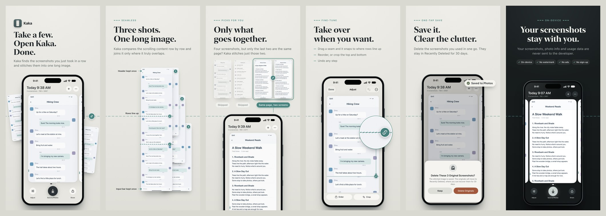

# Kaka

> The mountain has watched a thousand years of cloud shadows\
> and kept its silence;\
> the tree has seen a hundred years of dawn and dusk\
> and never stirred.\
> Yet we are guests who pass in a moment—\
> why fret about running out of time?
>
> Sometimes we are not living,\
> but trying to govern every answer life gives back:\
> whether the sky will clear,\
> whether someone will reply,\
> whether the heart will be understood.\
> To truly live\
> is to allow that none of these\
> may turn out as we hoped.

A long-screenshot stitcher for iPhone and iPad: take a few overlapping screenshots, open Kaka, and the long image is already waiting.



[中文](README.zh.md)

## Features

- With Photos access, finds recent screenshots that belong to the same scrolling page and stitches them automatically; seams that cannot be aligned reliably are skipped
- Manual mode through the system photo picker: choose, reorder, crop and fine-tune seams, without granting access to the whole library
- All processing on the device; PNG and JPEG export, no watermark
- Save to Photos or share through the system share sheet; afterwards, optionally delete the source screenshots, with confirmation first
- Interface in Simplified Chinese, Traditional Chinese, English, Japanese, French, Korean and Spanish

## Requirements

- macOS with Xcode 26 or later (Swift 6.2+)
- Target: iOS / iPadOS 18 or later
- Apple system frameworks and the Swift package in this repository; no other dependencies

## Build

Open `Kaka.xcodeproj` in Xcode, choose the `Kaka` scheme and any iPhone or iPad simulator, and press Run. On a device, choose your own Team under **Signing & Capabilities** and replace the placeholder `com.example.kaka` with a unique bundle identifier.

Unsigned iOS build from the command line:

```sh
xcodebuild -project Kaka.xcodeproj -scheme Kaka \
  -destination 'generic/platform=iOS' CODE_SIGNING_ALLOWED=NO build
```

The project is defined in `project.yml`. After changing it, regenerate `Kaka.xcodeproj` with XcodeGen:

```sh
xcodegen generate
```

## Tests and demo

```sh
swift test --package-path StitchCore
./Tools/test-ios-services-macos.sh
```

`KakaTests` can also be run from the `Kaka` scheme in Xcode.

Debug builds accept these launch arguments:

| Argument | Effect |
| --- | --- |
| `-demo` | Use synthetic screenshots instead of the photo library |
| `-demo-mixed` | Show four screenshots of which only the last two belong together |

Generate the synthetic samples (add `--english` for English text):

```sh
swift run --package-path StitchCore StitchDemo Fixtures
```

## Project structure

| Path | Purpose |
| --- | --- |
| `Kaka/App` | App entry point and state setup |
| `Kaka/UI` | Home, editor, preview, settings and offline documents |
| `Kaka/Services` | System photo picker, PhotoKit and sharing |
| `Kaka/Assets.xcassets` | App icon and visual assets |
| `StitchCore/Sources/StitchCore` | Image decoding, overlap matching, seam computation, rendering and export |
| `StitchCore/Sources/StitchWorkflow` | Recent-screenshot scanning, grouping, result list and editing sessions |
| `StitchCore/Sources/StitchDemo` | Synthetic screenshots and expected stitch results |
| `StitchCore/Tests`, `KakaTests` | Stitching, workflow and app service tests |
| `Fixtures` | Synthetic chat, article and list screenshots for tests and demos |
| `Tools` | macOS service tests, icon generation and launch-time measurement |
| `previews` | App Store screenshots and marketing images |

## Acknowledgements

The stitching algorithm was designed with reference to two MIT projects:

- **xudaniel**: [*scroll-screenshot-stitcher*](https://github.com/xudaniel/scroll-screenshot-stitcher). Multi-band row descriptors and FFT candidate search.
- **mate-matt**: [*screenshot-stitcher*](https://github.com/mate-matt/screenshot-stitcher). Local overlap verification and seam coordination.

The Swift matcher was written for this project. Sources and license texts are bundled with the app; see [`THIRD_PARTY_NOTICES.md`](THIRD_PARTY_NOTICES.md).

## License

[MIT](LICENSE)
