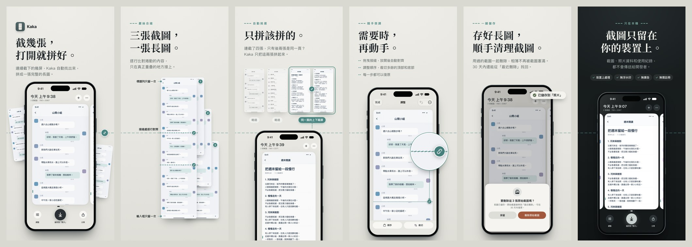

# Kaka

> The mountain has watched a thousand years of cloud shadows\
> and kept its silence;\
> the tree has seen a hundred years of dawn and dusk\
> and never stirred.\
> Yet we are guests who pass in a moment—\
> why fret about running out of time?
>
> Sometimes we are not living,\
> but trying to govern every answer life gives back:\
> whether the sky will clear,\
> whether someone will reply,\
> whether the heart will be understood.\
> To truly live\
> is to allow that none of these\
> may turn out as we hoped.

> 山看过千年云影不语，\
> 树见过百年晨昏不动。\
> 却只是一瞬的过客，\
> 何必为“来不及”而焦虑？
>
> 有时候不是在生活，\
> 而是在试图掌控生活的一切反应，天是否放晴、人是否回话、心是否被懂。\
> 真正地活着，\
> 是允许这些都不如愿。

iPhone 和 iPad 长截图拼接工具：连续截几张画面有重叠的截图，打开 Kaka，长图已经拼好。



[English](README.md)

## 特性

- 授权读取照片后，从近期截图中找出属于同一段滚动内容的图片并自动拼接；无法可靠对齐的接缝会跳过
- 也可通过系统照片选择器手动选图、调整顺序、裁剪、微调接缝，无需授予整个图库的读取权限
- 全部处理在设备上完成；导出 PNG 和 JPEG，无水印
- 保存到相册或通过系统分享；保存后可选择清理参与拼接的原截图，删除前会征求确认
- 界面支持简体中文、繁體中文、英语、日语、法语、韩语和西班牙语

## 环境要求

- macOS，Xcode 26 或更新版本（Swift 6.2+）
- 目标系统：iOS / iPadOS 18 或更新版本
- 仅使用 Apple 系统框架和仓库内的 Swift Package，无其他依赖

## 构建

用 Xcode 打开 `Kaka.xcodeproj`，选择 `Kaka` scheme 和任意 iPhone 或 iPad 模拟器，按 Run。真机需要在 **Signing & Capabilities** 里选择你自己的 Team，并把占位标识 `com.example.kaka` 换成自己的唯一 Bundle Identifier。

命令行无签名 iOS 编译：

```sh
xcodebuild -project Kaka.xcodeproj -scheme Kaka \
  -destination 'generic/platform=iOS' CODE_SIGNING_ALLOWED=NO build
```

工程配置源文件为 `project.yml`。修改后用 XcodeGen 重新生成 `Kaka.xcodeproj`：

```sh
xcodegen generate
```

## 测试与演示

```sh
swift test --package-path StitchCore
./Tools/test-ios-services-macos.sh
```

也可以在 Xcode 的 `Kaka` scheme 下运行 `KakaTests`。

调试构建支持以下启动参数：

| 参数 | 作用 |
| --- | --- |
| `-demo` | 用合成截图代替照片图库 |
| `-demo-mixed` | 演示四张截图中只有最后两张属于同一组的情形 |

生成合成样例（加 `--english` 生成英文版）：

```sh
swift run --package-path StitchCore StitchDemo Fixtures
```

## 项目结构

| 路径 | 用途 |
| --- | --- |
| `Kaka/App` | App 入口和状态初始化 |
| `Kaka/UI` | 首页、编辑器、预览、设置和离线文档 |
| `Kaka/Services` | 系统选图器、PhotoKit 和分享接口 |
| `Kaka/Assets.xcassets` | App 图标和视觉资源 |
| `StitchCore/Sources/StitchCore` | 图像解码、重叠匹配、接缝计算、渲染和导出 |
| `StitchCore/Sources/StitchWorkflow` | 近期截图扫描、分组、结果列表和编辑会话 |
| `StitchCore/Sources/StitchDemo` | 生成合成截图和预期拼接结果 |
| `StitchCore/Tests`、`KakaTests` | 拼接、工作流和 App 服务测试 |
| `Fixtures` | 合成的聊天、文章和列表截图，用于测试和调试演示 |
| `Tools` | macOS 服务测试、图标生成和启动耗时测量工具 |
| `previews` | App Store 截图和宣传图 |

## 致谢

拼接算法的设计参考了两个 MIT 项目：

- **xudaniel**：[*scroll-screenshot-stitcher*](https://github.com/xudaniel/scroll-screenshot-stitcher)。多频带行描述子与 FFT 候选搜索。
- **mate-matt**：[*screenshot-stitcher*](https://github.com/mate-matt/screenshot-stitcher)。局部重叠校验与接缝协调。

Swift 匹配器为本项目编写。来源和许可文本随 App 一起打包，见 [`THIRD_PARTY_NOTICES.md`](THIRD_PARTY_NOTICES.md)。

## 许可

[MIT](LICENSE)
